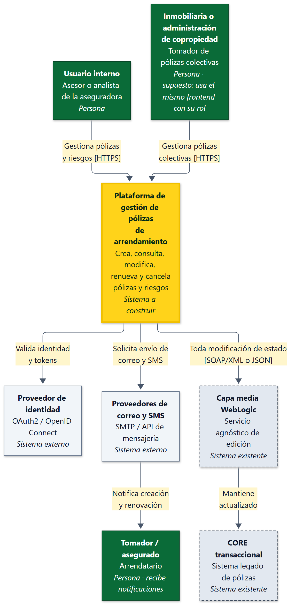
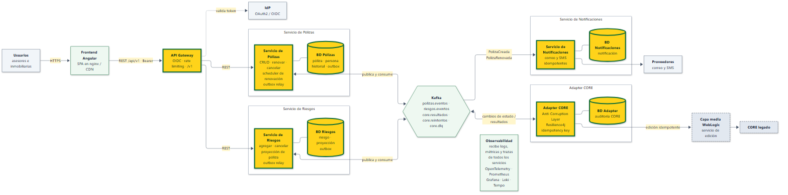
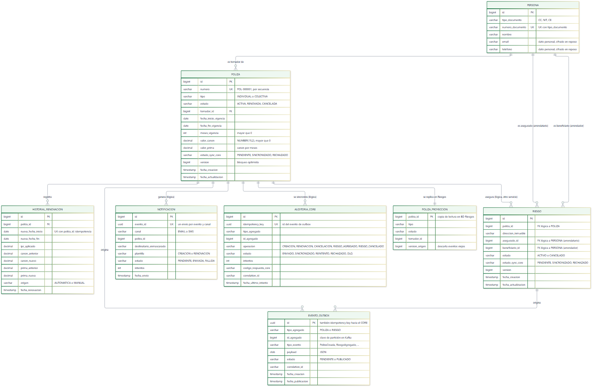
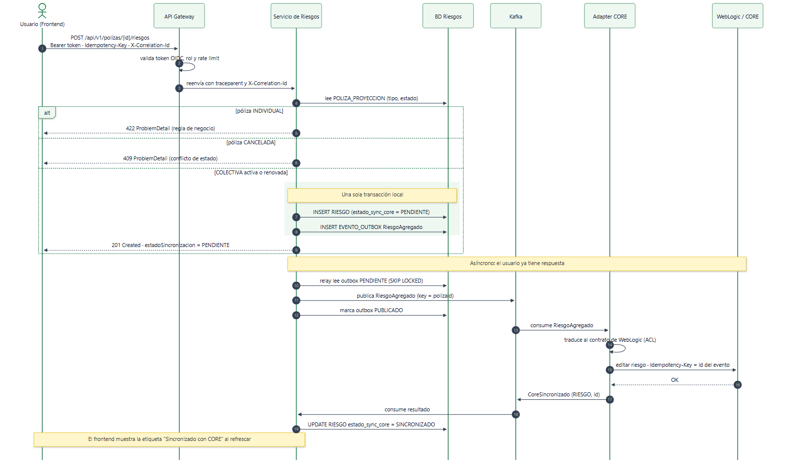
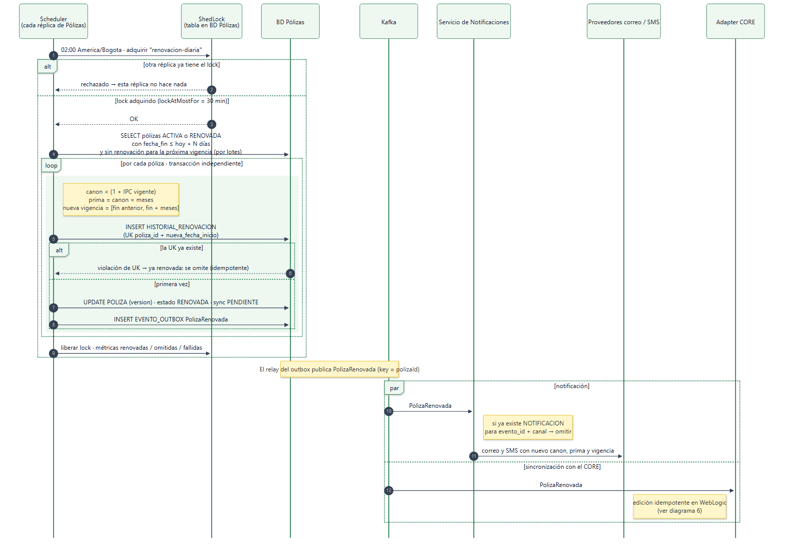
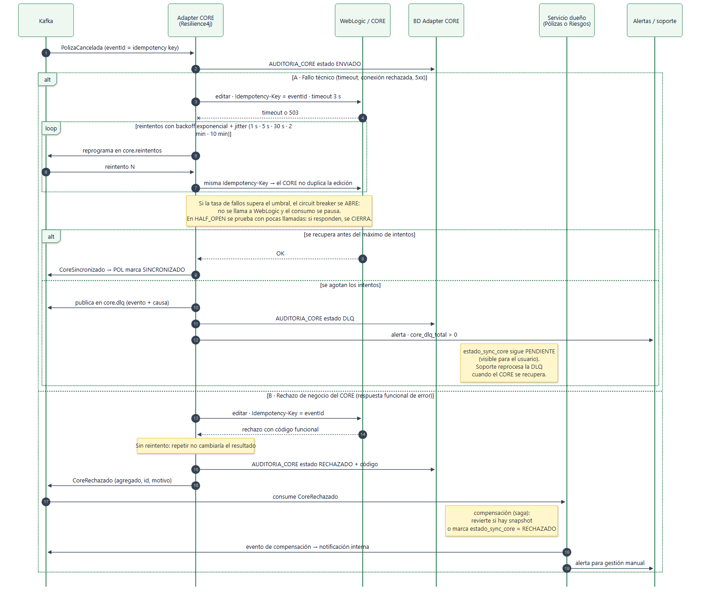
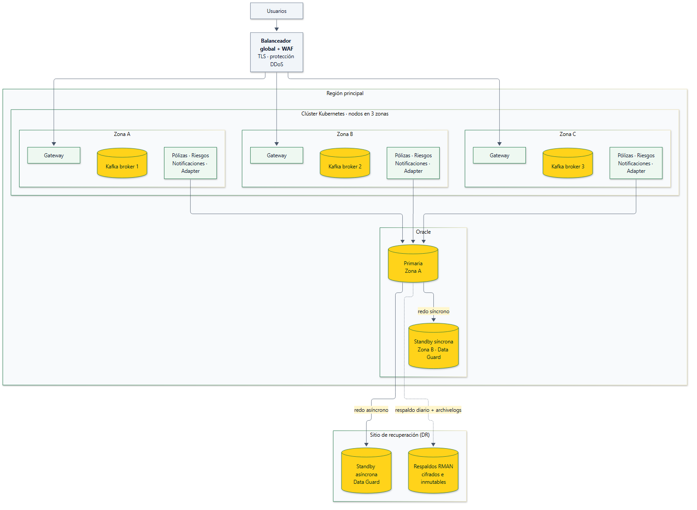

# Arquitectura: Plataforma de gestión de pólizas de arrendamiento

**Módulo 1: Diseño de sistema** · Prueba técnica Seguros Bolívar · Versión 1.0

> Este documento describe la arquitectura objetivo para producción. La API construida en el Módulo 2 (`02-api-polizas/`) implementa una parte de ella como monolito modular. La sección 8 indica con exactitud qué está implementado y qué es propuesta.

---

## 1. Resumen ejecutivo y supuestos

La plataforma gestiona pólizas de arrendamiento **individuales** (un riesgo, el arrendatario es tomador y asegurado) y **colectivas** (inmobiliarias y copropiedades, de 1 a n riesgos), con prima = canon × meses y **renovación automática** ajustada por IPC.

Se propone:
- **Tres microservicios de negocio** (Pólizas, Riesgos y Notificaciones) detrás de un **API Gateway**.
- Un **Adapter CORE** que actúa como capa anticorrupción frente al servicio de edición de **WebLogic**.
- Integración **orientada a eventos con Kafka y Transactional Outbox**: ningún cambio se pierde, aunque el CORE legado esté caído.

La plataforma es la fuente de verdad operativa. El CORE se sincroniza de forma asíncrona, idempotente y observable, y cada póliza y riesgo expone su **estado de sincronización**. Con despliegue multi-zona y Oracle con Data Guard, el objetivo de disponibilidad es **99,9 %**.

**Supuestos.** No hay información de la empresa para validarlos:

| # | Supuesto | Impacto si cambia |
|---|---|---|
| S1 | No se conocen volúmenes ni picos; se diseña para escalar horizontalmente | Dimensionamiento de réplicas y particiones |
| S2 | El contrato de WebLogic (SOAP/XML o JSON) y sus códigos de error son desconocidos | Solo cambia el Adapter CORE (ACL) |
| S3 | No se sabe si WebLogic acepta una clave de idempotencia | Si no la acepta, el Adapter deduplica con su tabla de auditoría (§3.3) |
| S4 | Existe un proveedor de identidad corporativo compatible con OIDC | Gateway y frontend |
| S5 | Oracle es la base de datos corporativa | Modelo y alta disponibilidad (Data Guard) |
| S6 | Correo y SMS se envían mediante proveedores externos | Servicio de Notificaciones |
| S7 | El IPC lo parametriza negocio (fuente oficial: DANE) y la renovación automática corre N días antes del vencimiento (N configurable) | Scheduler de renovación |
| S8 | Las inmobiliarias usan el mismo frontend con un rol propio | Contexto y autorización |

---

## 2. Arquitectura de alto nivel

### 2.1 Contexto (C4 nivel 1)

### 2.2 Contenedores (C4 nivel 2)

En amarillo con borde grueso están los seis componentes que pide el enunciado: API Gateway, Servicio de Pólizas, Servicio de Riesgos, Servicio de Notificaciones, Adapter CORE y bases de datos.

### 2.3 Responsabilidades

| Contenedor | Responsabilidad | Datos propios | Escala por |
|---|---|---|---|
| **API Gateway** | Autenticación OIDC, autorización por *scopes*, rate limiting, enrutamiento y versionamiento `/v1` | — | Peticiones por segundo |
| **Servicio de Pólizas** | Crear, consultar, modificar, renovar (manual y automática) y cancelar pólizas; scheduler de renovación con ShedLock; publicar eventos de póliza | BD Pólizas | Peticiones; un solo nodo ejecuta el job a la vez |
| **Servicio de Riesgos** | Agregar y cancelar riesgos validando contra una **proyección local** de la póliza; cancelar en cascada al recibir `PolizaCancelada` | BD Riesgos | Peticiones y particiones de Kafka |
| **Servicio de Notificaciones** | Correo y SMS en creación y renovación, idempotentes por evento y canal | BD Notificaciones | Particiones de Kafka |
| **Adapter CORE** | Anticorrupción frente a WebLogic: traducción, idempotency key, reintentos, circuit breaker, DLQ y auditoría | BD Adapter (auditoría) | Particiones; limitado por la capacidad de WebLogic (bulkhead) |
| **Kafka** | Transporte de eventos con orden por póliza (clave de partición = `polizaId`) | Topics | Brokers y particiones |
| **Bases de datos** | Oracle con un esquema por servicio; ningún servicio lee el esquema de otro | — | Réplicas de lectura (Active Data Guard) |

---

## 3. Patrones de arquitectura

### 3.1 Microservicios + API Gateway

| | |
|---|---|
| **Problema en este caso** | Las capacidades tienen ritmos distintos: las consultas de pólizas reciben mucho tráfico, la renovación es un proceso batch diario, las notificaciones dependen de proveedores externos y la integración con el CORE está limitada por un sistema legado. En un único despliegue, un pico o una falla en una arrastra a las demás. |
| **Cómo se aplica** | Pólizas, Riesgos y Notificaciones se despliegan y escalan por separado, cada uno con su esquema. El Gateway es la única entrada: valida tokens OIDC, aplica rate limiting y expone `/api/v1`. |
| **Trade-offs** | Más piezas que operar (CI/CD, observabilidad distribuida). La póliza deja de estar en la misma transacción que sus riesgos, lo que introduce **consistencia eventual** (ver abajo). |
| **Alternativa descartada** | Monolito único: más simple, pero escala y falla como una sola unidad. |

**Separación de Pólizas y Riesgos: consistencia eventual con proyección local.** En el dominio, la póliza es la raíz del agregado de sus riesgos. Al separarlos:

- **Riesgos mantiene `POLIZA_PROYECCION`** (tipo, estado, versión), alimentada por eventos de póliza. Con ella valida, sin llamar a Pólizas, las reglas "solo colectivas" (422) y "no canceladas" (409).
- **La cascada de cancelación** es el evento `PolizaCancelada`, que Riesgos consume de forma idempotente y con el que cancela todos los riesgos activos de esa póliza.
- **Ventana de inconsistencia.** Si alguien agrega un riesgo justo cuando la póliza se cancela, el sistema converge: el consumidor cancela todo riesgo activo, incluido el recién creado. La ventana dura lo que tarda en propagarse el evento (normalmente milisegundos).
- **Proyección ausente.** Si la póliza aún no llegó a la proyección, Riesgos consulta a Pólizas de forma síncrona (*read-through*) en lugar de rechazar.

**Alternativa válida y más fiel al DDD: un solo servicio "Pólizas y Riesgos"** con Riesgos como módulo interno. Conserva el agregado en una transacción (sin proyección ni ventana de inconsistencia) y la preferiría con un **equipo pequeño, bajo volumen o poca diferencia de carga** entre ambas capacidades. Es el **punto de partida natural**: el Módulo 2 ya es ese monolito modular, con las reglas en el agregado `Poliza` y los puertos definidos. Extraer Riesgos después es un cambio de despliegue, no de modelo.

### 3.2 Arquitectura hexagonal + Anti-Corruption Layer (ACL)

| | |
|---|---|
| **Problema en este caso** | El CORE es legado y su contrato (SOAP/XML o JSON vía WebLogic) no debe contaminar el modelo de dominio. Además, es la integración con más riesgo de falla. |
| **Cómo se aplica** | El dominio declara un **puerto** (`CorePort`) con su propio lenguaje: `EventoCore(evento, operacion, polizaId)`. El **Adapter CORE** lo traduce al contrato de WebLogic, agrega la idempotency key, aplica Resilience4j y audita cada llamada. Los servicios de negocio no conocen WebLogic. |
| **Trade-offs** | Una capa de traducción más que mantener. Los cambios en el contrato del CORE pasan por el adapter. |
| **Alternativa descartada** | Llamar a WebLogic desde los servicios de negocio: acopla el dominio a un contrato legado y dispersa la lógica de reintentos. |

**Ya implementado en el Módulo 2:** `CorePort` (dominio) + `CoreHttpAdapter` (infraestructura) con timeouts. Hoy la llamada es síncrona y un fallo solo se registra en logs; la evolución es mover ese adaptador a un servicio que consume del outbox.

### 3.3 Event-driven + Transactional Outbox

| | |
|---|---|
| **Problema en este caso** | Al crear o renovar hay que notificar y, en **toda** modificación, avisar al CORE. Escribir en la base de datos y publicar en Kafka son dos sistemas: si uno falla entre ambos pasos (*dual write*), se pierden eventos o se publican cambios que nunca se confirmaron. |
| **Cómo se aplica** | En la **misma transacción** del cambio se inserta una fila en `EVENTO_OUTBOX`. Un *relay* (consulta con `SELECT … FOR UPDATE SKIP LOCKED`, o CDC con Debezium) publica en Kafka con clave `polizaId` y la marca como publicada. Notificaciones y el Adapter CORE consumen. El `id` del evento es la **idempotency key** hacia WebLogic y hacia los consumidores. |
| **Trade-offs** | Entrega **al menos una vez**: los consumidores deben ser idempotentes. Hay latencia entre el cambio y su efecto en el CORE, y el outbox se debe purgar (particionado por fecha). |
| **Alternativa descartada** | Eventos en memoria tras el commit (lo que hace hoy el Módulo 2 con `@TransactionalEventListener`): si el proceso cae justo después del commit, el evento se pierde. |

**Idempotencia hacia el CORE:** cada llamada a WebLogic lleva `Idempotency-Key = id del evento`. Los reintentos repiten la misma clave, así que el CORE no duplica ediciones. Si WebLogic no soporta claves (S3), el Adapter consulta `AUDITORIA_CORE` (clave única) antes de reenviar y, si existe, la operación de consulta del CORE.

### 3.4 CQRS: evaluado y diferido

Las lecturas son consultas simples por filtro e identificador, y no hay evidencia de una carga de lectura muy asimétrica (S1). CQRS completo (modelos y almacenes de lectura separados) agregaría otra fuente de consistencia eventual sin beneficio demostrado. **Se difiere.** Si las consultas crecen, el primer paso son **réplicas de lectura** (Active Data Guard) y caché; CQRS se reconsidera si aparecen vistas de reporte complejas.

---

## 4. Modelo de datos

**Reglas que impone el modelo**

| Regla | Cómo se garantiza |
|---|---|
| INDIVIDUAL tiene exactamente 1 riesgo y el arrendatario es el tomador | Validación del agregado al crear (`riesgo.asegurado_id = poliza.tomador_id`) y en Riesgos con la proyección |
| COLECTIVA tiene de 1 a n riesgos; arrendatario = asegurado y arrendador = beneficiario | `asegurado_id` y `beneficiario_id` de cada riesgo apuntan a `PERSONA` |
| prima = canon × meses, con dinero en `NUMBER(15,2)` | Calculada en el dominio (escala 2, `HALF_EVEN`) más `CHECK` en BD |
| Una renovación por vigencia (idempotencia del job) | `UNIQUE (poliza_id, nueva_fecha_inicio)` en `HISTORIAL_RENOVACION` |
| Una notificación por evento y canal | `UNIQUE (evento_id, canal)` en `NOTIFICACION` |
| Una edición en el CORE por evento | `UNIQUE (idempotency_key)` en `AUDITORIA_CORE` |
| Sin actualizaciones perdidas por concurrencia | Columna `version` (bloqueo optimista) que responde 409 |
| El estado del CORE es visible | `estado_sync_core` ∈ {PENDIENTE, SINCRONIZADO, RECHAZADO} en `POLIZA` y `RIESGO` |

**Base de datos por servicio.** Son esquemas Oracle separados en el mismo clúster con alta disponibilidad: aislamiento lógico sin multiplicar licencias ni operación.

| Servicio | Esquema | Tablas |
|---|---|---|
| Pólizas | `POLIZAS` | `PERSONA`, `POLIZA`, `HISTORIAL_RENOVACION`, `EVENTO_OUTBOX`, `SHEDLOCK` |
| Riesgos | `RIESGOS` | `RIESGO`, `POLIZA_PROYECCION`, `EVENTO_OUTBOX` |
| Notificaciones | `NOTIFICACIONES` | `NOTIFICACION` |
| Adapter CORE | `CORE_ADAPTER` | `AUDITORIA_CORE` |

Entre esquemas solo hay **FK lógicas** (sin `FOREIGN KEY` física): cada servicio puede evolucionar y desplegarse por separado. `PERSONA` vive en Pólizas mientras no exista un maestro de clientes corporativo; si existe, se reemplaza por una referencia a él.

**Diferencia con el Módulo 2:** allí tomador, arrendatario y arrendador son texto, y no hay `PERSONA`, historial, outbox ni `estado_sync_core` (decisión documentada en `02-api-polizas/backend/DECISIONES.md`).

---

## 5. Flujos clave

### 5.1 Agregar riesgo a una póliza colectiva

**Cómo ve el usuario la sincronización con el CORE (propuesta)**

> Ni la API ni el frontend del Módulo 2 tienen todavía este estado de sincronización: depende del outbox y del `estado_sync_core` propuestos (ver §8).

| Canal | Comportamiento |
|---|---|
| API | Responde **201/200** con `estadoSincronizacion: "PENDIENTE"`. Se descarta 202: la operación **ya quedó confirmada y es durable** en la plataforma, que es la fuente de verdad; solo falta propagarla. `GET` devuelve `estadoSincronizacion` y, si fue rechazada, `motivoRechazo`. |
| Frontend (propuesta) | Etiqueta junto al estado: "Pendiente de sincronizar con CORE" (gris), "Sincronizado" (verde) o "Rechazado por CORE" (rojo, con el motivo y el código de seguimiento). La vista se actualiza al recargar; más adelante, con SSE si se requiere tiempo real. |

### 5.2 Renovación automática

- **Una sola ejecución:** el job corre en todas las réplicas, pero ShedLock garantiza que solo una lo ejecute. `lockAtMostFor` libera el lock si esa réplica muere.
- **Idempotencia:** si el job se reintenta o se solapa, la clave única de `HISTORIAL_RENOVACION` impide renovar dos veces la misma vigencia.
- **Aislamiento de fallos:** cada póliza se procesa en su propia transacción, así que un fallo no detiene el lote. Las métricas `renovaciones_{ok,omitidas,fallidas}` alimentan alertas.

### 5.3 Fallo del CORE: técnico frente a rechazo de negocio

| | A · Fallo técnico | B · Rechazo de negocio |
|---|---|---|
| Ejemplos | Timeout, conexión rechazada, HTTP 5xx, WebLogic caído | Código funcional de error del CORE (p. ej. la entidad no existe en el CORE o el estado no lo permite) |
| ¿Reintentar? | **Sí**, con backoff exponencial y jitter, y siempre la misma idempotency key | **No**: repetir no cambia el resultado |
| Protección | Circuit breaker (abierto → pausa el consumo), bulkhead y timeout | — |
| Al agotar | `core.dlq` + alerta; `estado_sync_core` sigue PENDIENTE; reproceso manual | Compensación (saga), notificación interna y alerta |
| Estado final | SINCRONIZADO al recuperarse | RECHAZADO (o revertido) |

**Compensación por operación ante un rechazo de negocio**

| Operación | Compensación |
|---|---|
| Crear póliza | Se marca RECHAZADO; la póliza queda bloqueada para nuevas operaciones hasta gestión manual (no se borra, por auditoría) |
| Renovar | Se revierte a los valores y la vigencia anteriores desde `HISTORIAL_RENOVACION` (snapshot) |
| Cancelar póliza o riesgo | Se marca RECHAZADO; no se revierte la cancelación automáticamente (es decisión de negocio) |
| Agregar riesgo | El riesgo local pasa a CANCELADO con `estado_sync_core = RECHAZADO` |

---

## 6. Atributos de calidad

### 6.1 Escalabilidad

| Técnica | Aplicación |
|---|---|
| Servicios *stateless* | Sin sesión en memoria (como en el Módulo 2); cualquier réplica atiende cualquier petición |
| Escalado horizontal | HPA de Kubernetes por CPU y peticiones por segundo; los consumidores escalan hasta el número de particiones |
| Particionamiento | Kafka por `polizaId` (orden por póliza y paralelismo). Oracle con particionado por intervalo de fecha en outbox, auditoría y notificaciones (purga barata) |
| Réplicas de lectura | Active Data Guard para consultas y reportes |
| Caché | Parámetros (IPC) y catálogos en caché local (Caffeine) con TTL; las consultas de detalle se cachean solo si las métricas lo justifican |
| Paginación | Listados con `Pageable` (en el Módulo 2 el listado aún no está paginado) |

### 6.2 Logs y observabilidad

| Señal | Herramienta | Detalle |
|---|---|---|
| Logs | JSON (ECS) con `correlationId` → Loki o Elastic | **Ya implementado** en el Módulo 2 (perfil `json`) |
| Métricas | Micrometer + Prometheus | RED por endpoint; de negocio: antigüedad de pendientes de sincronización, rezago del outbox, tamaño de la DLQ, renovaciones |
| Trazas | OpenTelemetry → Tempo o Jaeger | `traceparent` también en los headers de Kafka: una traza cruza Gateway → servicio → Kafka → Adapter → WebLogic |
| Dashboards y alertas | Grafana | Alertas por *burn rate* de SLO, no por umbrales sueltos |

**SLOs propuestos** (a validar con negocio):

| SLO | Objetivo |
|---|---|
| Disponibilidad de la API | 99,9 % de respuestas no-5xx en 30 días |
| Latencia de consultas | p95 < 300 ms |
| Sincronización con el CORE | 99 % de los cambios SINCRONIZADO en menos de 5 min |
| Renovación automática | Job diario completado antes de las 06:00 |

### 6.3 Tolerancia a fallos

| Mecanismo | Dónde |
|---|---|
| Timeout, retry con backoff y jitter, circuit breaker y bulkhead (Resilience4j) | Adapter CORE y llamadas a proveedores |
| Transactional Outbox | Pólizas y Riesgos |
| Consumidores idempotentes | Riesgos (proyección y cascada), Notificaciones, Adapter |
| DLQ + reproceso | `core.dlq` y una DLQ por consumidor |
| `Idempotency-Key` en POST públicos | Gateway y servicios: evita duplicados cuando el cliente reintenta |
| Health checks (liveness y readiness) | Actuator en cada servicio |
| Despliegue sin caída | Rolling o canary con rollback automático por SLO; blue-green para cambios de esquema |
| Multi-zona | Réplicas en 3 zonas, Kafka con factor de replicación 3 y `min.insync.replicas=2` |

### 6.4 Versionamiento de APIs

| Aspecto | Decisión |
|---|---|
| Estrategia | **Versión mayor en la URI** (`/api/v1/...`), gestionada en el Gateway. Es explícita, cacheable y fácil de enrutar. Se descarta versionar por header por ser menos visible para los consumidores. |
| Compatibilidad | Dentro de una versión mayor solo hay cambios aditivos (campos opcionales nuevos, endpoints nuevos). Romper el contrato exige `/v2`, desplegado en paralelo. |
| Deprecación | Headers `Deprecation` (RFC 9745) y `Sunset` (RFC 8594) más un enlace a la guía de migración. Ventana mínima propuesta: 6 meses. |
| Contratos | OpenAPI versionado en el repositorio (ya generado con springdoc) y pruebas de contrato con los consumidores |
| Eventos | Los esquemas de eventos también se versionan (Schema Registry con compatibilidad *backward*) |

### 6.5 Seguridad

| Aspecto | Propuesta |
|---|---|
| Identidad | OAuth2/OIDC: el frontend obtiene tokens del IdP (Authorization Code + PKCE). El Gateway los valida y los servicios verifican *scopes* (p. ej. `polizas:escribir`). |
| Entre servicios | mTLS (service mesh, p. ej. Istio o Linkerd) y principio de mínimo privilegio |
| Secretos | Vault o *External Secrets* (equivalentes: AWS Secrets Manager, Azure Key Vault); nunca en imágenes ni repositorios |
| Datos personales | Correo y teléfono cifrados en reposo, enmascarados en logs y notificaciones; cumplimiento de la Ley 1581 de 2012 (habeas data) |
| OWASP API Top 10 | Ver Anexo B |

---

## 7. Disponibilidad 24/7

| Elemento | Decisión |
|---|---|
| **SLA objetivo propuesto** | **99,9 %** mensual (≈ 43 min de indisponibilidad al mes). No es un dato de la empresa; se valida con negocio. |
| Sin puntos únicos de falla | Gateway y servicios con ≥ 2 réplicas por zona en 3 zonas; Kafka con 3 brokers; Oracle primaria + standby síncrona en otra zona con *fast-start failover* |
| **Degradación controlada** | Si el CORE o WebLogic caen, la plataforma **sigue operando**: los cambios quedan PENDIENTES y se sincronizan al recuperarse. Si un proveedor de correo o SMS falla, la notificación se reintenta sin afectar la operación. |
| Respaldo | RMAN completo semanal, incremental diario y *archivelogs* continuos; cifrados, inmutables y en otro sitio. Restauración probada trimestralmente. |
| **RPO / RTO propuestos** | Falla de zona: **RPO 0**, RTO ≤ 15 min (automático). Falla de región: RPO ≤ 5 min (Data Guard asíncrono), RTO ≤ 1 h (procedimiento ensayado). |

---

## 8. Trazabilidad: diseño frente a implementación del Módulo 2

Rutas relativas a `02-api-polizas/`. Abreviaturas: `be` = `backend/src/main/java/com/segurosbolivar/polizas`, `fe` = `frontend/src/app`.

| Decisión de diseño | Estado | Dónde (Módulo 2) |
|---|---|---|
| Arquitectura hexagonal (dominio, aplicación, infraestructura) | **Implementado** | `be/domain`, `be/application`, `be/infrastructure` |
| Reglas de negocio en el agregado `Poliza` | **Implementado** | `be/domain/model/Poliza.java` |
| Puerto CORE + adaptador (ACL) | **Implementado** | `be/domain/port/CorePort.java`, `be/infrastructure/core/CoreHttpAdapter.java` |
| Contrato `evento = ACTUALIZACION` + `operacion` | **Implementado** | `be/domain/port/EventoCore.java` |
| Timeouts hacia el CORE | **Implementado** | `be/infrastructure/core/CoreClientConfig.java` |
| Llamada al CORE asíncrona vía outbox + Kafka | **Simplificado**: síncrona tras el `flush`; el fallo se registra y no revierte | `be/application/PolizaService.java` |
| Retry, circuit breaker, DLQ (Resilience4j) | Propuesta | — |
| Idempotency key hacia el CORE | Propuesta | — |
| `estado_sync_core` en póliza y riesgo | Propuesta | — |
| `estadoSincronizacion` en la API y etiqueta de sincronización en el frontend | Propuesta (el frontend actual no la muestra) | — |
| Eventos de dominio + notificaciones tras el commit | **Simplificado**: en memoria (`@TransactionalEventListener`), correo y SMS simulados en logs | `be/infrastructure/notificacion/NotificacionService.java` |
| Transactional Outbox | Propuesta | — |
| Microservicios separados (Pólizas, Riesgos, Notificaciones, Adapter) | **Simplificado**: monolito modular, un despliegue | Todo `be/` |
| Renovación con IPC configurable | **Implementado** (manual) | `be/domain/model/Poliza.java#renovar`, `GET /parametros/renovacion` |
| Renovación automática (scheduler + ShedLock + historial) | Propuesta | — |
| Bloqueo optimista (`@Version`) → 409 | **Implementado** | `Poliza.java`, `Riesgo.java`, `GlobalExceptionHandler.java` |
| Errores RFC 9457 (ProblemDetail) | **Implementado** | `be/infrastructure/web/error/GlobalExceptionHandler.java` |
| `correlationId` por petición, propagado al CORE y visible en el frontend | **Implementado** | `be/infrastructure/config/CorrelationIdFilter.java`, `fe/core/http/interceptors.ts` |
| Logs JSON estructurados (ECS) | **Implementado** | `backend/src/main/resources/application-json.yml` |
| Métricas (Micrometer/Prometheus) y trazas (OpenTelemetry) | Propuesta | — |
| Health checks (Actuator) | Propuesta | — |
| Esquema versionado con Flyway, compatible con Oracle y H2 | **Implementado** | `backend/src/main/resources/db/migration` |
| Oracle + Docker Compose | **Implementado** | `backend/docker-compose.yml` |
| OAuth2/OIDC en el Gateway | **Simplificado**: API key en un filtro | `be/infrastructure/security/ApiKeyFilter.java` |
| CORS restringido y proxy del mismo origen | **Implementado** | `SeguridadConfig.java`, `frontend/nginx/default.conf.template` |
| Versionamiento `/v1` en el Gateway | Propuesta (las rutas actuales no llevan versión) | — |
| `PERSONA` como entidad | **Simplificado**: texto | `be/domain/model/Poliza.java`, `Riesgo.java` |
| Paginación de listados | Propuesta | — |
| Frontend que refleja reglas sin duplicarlas | **Implementado** | `fe/features/polizas` |

---

## 9. Riesgos y siguientes pasos

| Riesgo | Mitigación |
|---|---|
| Contrato, errores y soporte de idempotencia de WebLogic desconocidos (S2, S3) | Prueba de concepto del Adapter contra WebLogic en el primer sprint; catálogo de códigos técnicos frente a funcionales |
| Orden de eventos: un reintento en `core.reintentos` podría adelantar un evento posterior de la misma póliza | El Adapter procesa en orden por `polizaId` y "estaciona" los eventos posteriores mientras haya uno pendiente de la misma póliza |
| Ventana de consistencia eventual Pólizas/Riesgos | Proyección con `version_origen`, *read-through* y cascada idempotente (§3.1); empezar como monolito modular si el equipo es pequeño |
| Costo operativo de microservicios | Plataforma común (plantillas, observabilidad y CI/CD); extracción gradual desde el monolito modular |
| CDC sobre Oracle (Debezium/LogMiner) complejo de operar | Empezar con un relay por consulta (`SKIP LOCKED`) |
| Datos personales | Cifrado, enmascaramiento y revisión de cumplimiento |

**Siguientes pasos.**

1. Prueba de concepto del Adapter CORE con el contrato real.
2. Agregar outbox, `estado_sync_core` y Resilience4j al Módulo 2 (monolito modular).
3. Actuator, Micrometer y OpenTelemetry.
4. Prefijo `/v1` y OIDC.
5. Scheduler de renovación con ShedLock.
6. Pruebas de carga para dimensionar (S1).
7. Extraer Notificaciones y luego Riesgos según métricas.

---

## Anexo A: Catálogo de eventos

| Evento | Productor | Consumidores | Clave |
|---|---|---|---|
| `PolizaCreada` (incluye riesgos iniciales) | Pólizas | Riesgos (crea riesgos y proyección), Notificaciones, Adapter CORE | `polizaId` |
| `PolizaRenovada` | Pólizas | Riesgos (proyección), Notificaciones, Adapter CORE | `polizaId` |
| `PolizaCancelada` | Pólizas | Riesgos (cascada), Adapter CORE | `polizaId` |
| `RiesgoAgregado` / `RiesgoCancelado` | Riesgos | Adapter CORE | `polizaId` |
| `CoreSincronizado` / `CoreRechazado` | Adapter CORE | Pólizas o Riesgos (estado de sincronización y compensación) | `polizaId` |

Todos los eventos llevan `eventId` (UUID, idempotencia), `correlationId`, `traceparent`, `version` del esquema y `ocurridoEn`.

## Anexo B: OWASP API Security Top 10 (2023)

| Riesgo | Mitigación |
|---|---|
| API1 Autorización a nivel de objeto | Verificar que el usuario (p. ej. una inmobiliaria) solo accede a sus pólizas |
| API2 Autenticación rota | OIDC en el Gateway, tokens de vida corta, sin credenciales en el frontend |
| API3 Autorización a nivel de propiedad | DTOs explícitos de entrada y salida (records en el Módulo 2), sin *mass assignment* |
| API4 Consumo de recursos sin límite | Rate limiting en el Gateway, paginación, límites de tamaño (p. ej. máx. 100 riesgos por petición, implementado) |
| API5 Autorización a nivel de función | *Scopes* por operación (renovar y cancelar requieren un rol específico) |
| API6 Acceso sin restricción a flujos de negocio | Idempotency-Key y límites por cliente en creación |
| API7 SSRF | La URL de WebLogic está en configuración, nunca la envía el cliente |
| API8 Configuración insegura | Sin stack traces (implementado), CORS restringido (implementado), cabeceras de seguridad en nginx (implementado) |
| API9 Inventario deficiente | OpenAPI versionado y política de deprecación |
| API10 Consumo inseguro de APIs | El Adapter valida y traduce las respuestas del CORE (ACL), con timeouts y circuit breaker |

## Anexo C: Equivalencias por proveedor de nube

| Componente | Agnóstico (propuesto) | AWS | Azure |
|---|---|---|---|
| Orquestación | Kubernetes | EKS | AKS |
| API Gateway | Kong o Spring Cloud Gateway | Amazon API Gateway | Azure API Management |
| Broker | Apache Kafka (o RabbitMQ) | Amazon MSK | Event Hubs (API Kafka) |
| Base de datos | Oracle + Data Guard | Amazon RDS for Oracle | Oracle Database@Azure |
| Identidad | IdP corporativo o Keycloak | Amazon Cognito | Microsoft Entra ID |
| Secretos | HashiCorp Vault | Secrets Manager | Key Vault |
| Observabilidad | OpenTelemetry, Prometheus, Grafana, Loki, Tempo | CloudWatch, X-Ray | Azure Monitor, Application Insights |

> **RabbitMQ como alternativa a Kafka:** es más simple de operar para colas de trabajo, pero Kafka ofrece orden por clave, retención y reproceso de eventos (útil para reconstruir la proyección de Riesgos o reprocesar el CORE). Por eso se prefiere Kafka.
